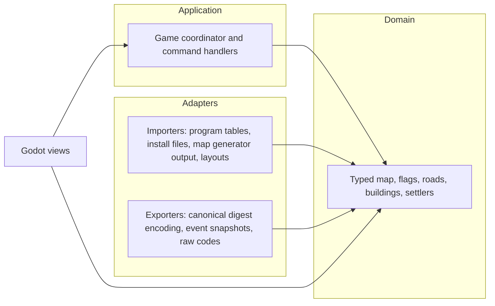

# 13. The simulation is typed, and the original's bytes stay at its edge

**Status:** Accepted

The simulation has an onion shape. Its core is a typed domain model: the map's nodes, flags, roads,
buildings, goods, and settlers, each with named fields and no packed bytes or bare codes of the original.
Around it, the application layer applies commands and runs the tick in the original's order. At the edge,
importers turn the original's bytes into the typed model, and exporters turn the typed model back into the
original's encoding where something outside needs it. The original kept its state in packed bytes because of
its memory and speed limits. [ADR 0003](0003-rule-fidelity-not-state-identity.md) asks the engine for the
original's rules, not its memory layout, so the engine holds its state in the form that states the rules
most plainly.

## Considered options

- Keep the original's bytes as the state and name them with accessors: the least work, but every rule
  keeps reading bit masks, and a field whose meaning depends on the state (the settler's mode and target)
  stays shared between unrelated behaviors.
- Layers as namespaces in one assembly, checked by a reflection test: no build change, but a wrong
  reference fails only at test time.
- A typed view over byte storage for the map only: smaller, but the rules would read two models, typed
  game state and a byte map behind a façade, and the map would follow later anyway.

## Consequences

- The map generator and the random generator stay byte-exact ports (INV-0003). The generator's output is
  imported into the typed map.
- The map view reads the typed map and the typed game state, never a map layer or a bit mask. The one exception is the thing readouts, which show the original's encoding of a settler or building through `SettlerEncoder` and `BuildingEncoder`. That display is read-only, and no rule takes it as input. The canonical
  digest and the event snapshots are exporters' output. Each exporter reproduces the original's encoding exactly, so `Game.Digest()` and
  the recorded events do not change with the representation.
- Tests that assert the original's bytes test an importer or an exporter. Tests of rules assert typed
  state.
- The domain, the application, and the adapters are separate class-library assemblies that the Godot project
  and the tests reference, so the compiler enforces the dependency direction (INV-0008). They use the plain
  .NET SDK and no Godot type.
- A field with no recovered meaning is kept as a named raw field in the typed model, so the exporters stay
  lossless.
