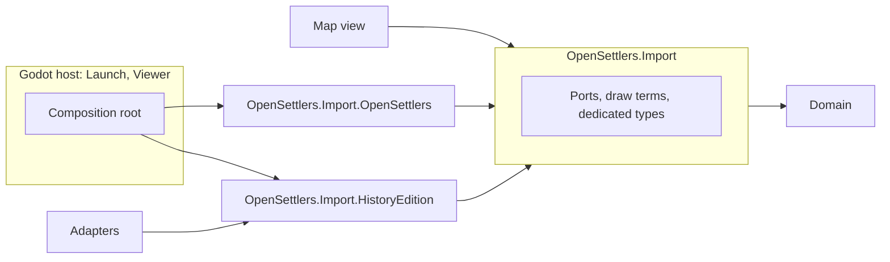

# 17. Game data enters through import ports, and each source is its own assembly

**Status:** Accepted

Amends [ADR 0013](0013-the-simulation-is-typed-and-the-original-s-bytes-stay-at-its-edge.md),
[ADR 0014](0014-the-map-view-draws-through-a-graphics-source.md), and
[ADR 0016](0016-jobs-are-types-and-each-layer-finds-its-job-modules.md).

The engine reaches game data only through import ports: one interface per kind of data. The ports and the
types they return live in their own assembly, `OpenSettlers.Import`: the graphics source with its draw
terms and images (ADR 0014), the rule tables port, the walk steps port, and the assets port. Each source
of game data is an assembly that implements the ports it can fill:

- `OpenSettlers.Import.HistoryEdition` reads a History Edition install. It holds the install, the readers
  of the original's file formats (internal), the program tables importer with its job tables modules, the
  History Edition graphics source with its entry tables and job looks, the walk steps, and the asset kinds
  of the asset browser. It implements every port.
- `OpenSettlers.Import.OpenSettlers` reads the repository's content set (ADR 0015). It implements the
  graphics source.

The Godot host is the composition root: the launch code builds the sources and gives each view the ports
it needs. The map view and the host name no type of a source assembly except where the host builds it.

ADR 0013 placed the importers in the adapter assembly. The program tables importer moves to the History
Edition assembly, and the adapter assembly keeps the exporters, the map generator, and the layouts. ADR 0014
placed the graphics sources in the map view; each moves to its source assembly, and the map view keeps the
code that builds draw terms. The job tables generator and the job looks generators of ADR 0016 run on the
assemblies that hold those modules.

## Considered options

- Ports and the History Edition implementation in one import assembly, and a graphics port that returns
  decoded images by archive entry: a smaller move, but the content set could not implement such a port,
  because it has no archive entries.
- Keep the program tables importer in the adapter assembly behind a port: no move of the job tables
  modules and their generator, but the reads of the program and of the data files would stay apart.
- One install facade with a method per kind of data: fewer interfaces, but every consumer and every test
  fake would see the whole install.
- An architecture test that keeps the format readers out of the map view, with the readers public: no
  move of the asset kinds, but the compiler would not enforce the boundary.

## Consequences

- The adapter assembly references the History Edition assembly for the job and state names.
- `RuleTables` exposes no raw array: each table the engine reads is a dedicated type or a typed accessor.
- The boundary of ADR 0014 between the shared map view and the History Edition source is an assembly
  boundary: the map view cannot name an entry table or a format type.
- The layouts (ADR 0009) are repository test fixtures and are not read through a port.
